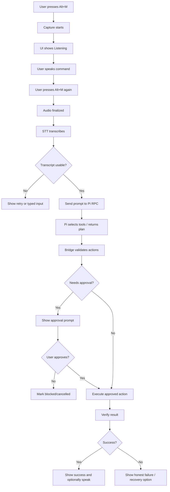
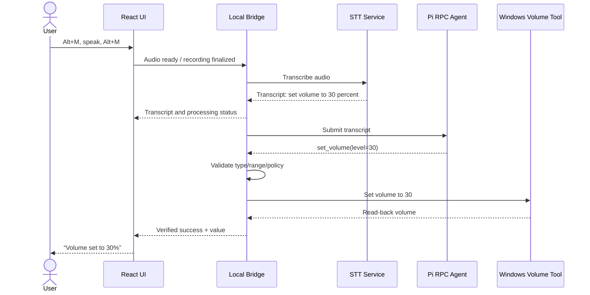
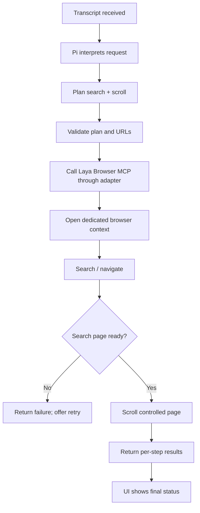
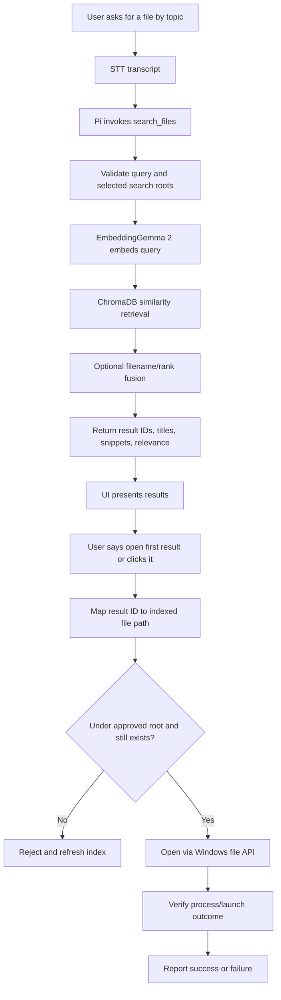
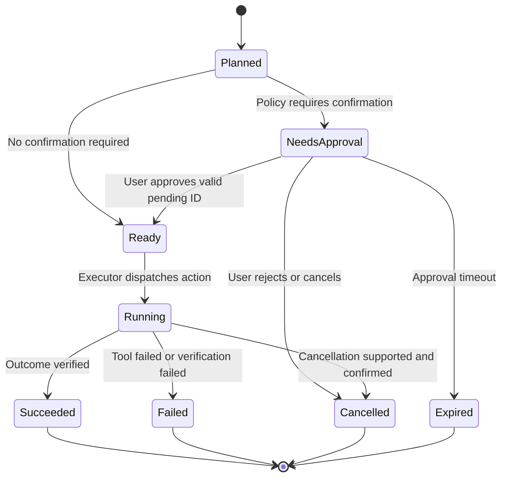
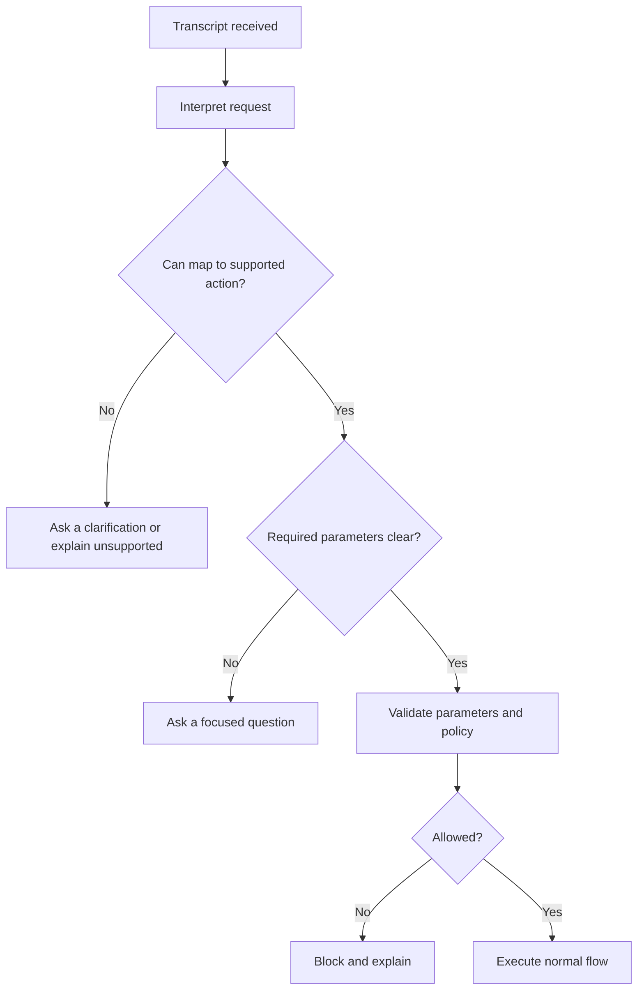

# VoicePilot — Application Flow Document

**Version:** 1.0  
**Status:** Draft for implementation  
**Related documents:** [PRD](01-prd.md), [Technical Requirements](02-technical-requirements.md), [Backend Schema](05-backend-schema.md)

## 1. Purpose

This document describes the end-to-end user journeys, screen states, task lifecycle, branching decisions, error handling, and acceptance flows for VoicePilot. The diagrams use Mermaid and can be previewed by most GitHub-compatible Markdown viewers.

## 2. Main application areas

1. **Home / Live Control:** microphone status, current transcript, interpreted request, plan, and execution status.
2. **Search Results:** semantic local-file results with snippets, paths (presented carefully), file types, and open actions.
3. **Activity:** recent commands and per-step outcomes.
4. **Settings:** STT/LLM configuration status, cloud/local processing disclosure, approved folders, hotkey status, voice response settings, and clear-history/index controls.
5. **Approval Dialog:** a modal/overlay that displays the exact pending action, its target, and Approve / Reject controls.

For the hackathon, Home, Approval, and a simple Activity panel are required. Dedicated Settings and Search pages can be minimal panels within the same window.

## 3. Primary voice-control flow

### Rules
- Alt+M is a global toggle, including when another app is focused.
- The UI displays recording state immediately and must not freeze while STT or LLM requests are running.
- The bridge assigns a unique `task_id` before work begins.
- Empty, garbled, or unsupported transcripts must not trigger a best-guess desktop action.
- A task should have one active execution queue in the MVP. New utterances while a task is running can be queued, rejected politely, or offered as an explicit interruption; they must not silently race another task.

## 4. Simple desktop action flow

Example: “Set my volume to 30 percent.”

### Acceptance criteria
- `level` is a number within 0–100.
- Volume changes only after the bridge validates the action.
- UI reports the read-back value, or reports an error if the system volume API fails.
- TTS is optional and cannot block UI status updates.

## 5. Browser-control flow

Example: “Search the web for TinyViT federated learning and scroll down.”

### Browser-specific policy
- The VoicePilot UI tab and controlled browser context are separate.
- Prefer a deterministic search URL/navigation call for simple search if supported and reliable; use Laya's model-based browser decisions when they add value.
- The browser adapter accepts only registered Laya operations; it does not let the LLM pass arbitrary JavaScript for execution.
- Browser page text is untrusted and may contain malicious instructions. It cannot change action permissions or override user intent.

## 6. Semantic file-search flow

Example: “Find the notes about federated learning, then open the first result.”

### File search requirements
- Only folders that the user explicitly selected are indexed.
- Search results use opaque IDs. The model cannot invent file paths and pass them to `open_file`.
- The index returns the filename, extension, concise matching snippet, and safe display path (e.g. root-relative).
- If no result is sufficiently relevant, say that no good match was found; do not open a weak match without user selection.
- If a file has changed or disappeared since indexing, refresh/reject the result rather than opening a different path.

## 7. Confirmation and cancellation flow

### Confirmation policy
- Request approval before closing an app when unsaved work could be lost or application state cannot be assessed.
- Request approval for disruptive, external, or potentially destructive actions.
- Opening allowlisted apps, scrolling, searching the web, and setting volume can normally proceed without confirmation.
- Rejection/expiry must guarantee that the corresponding action was not sent to the executor.
- Confirmation UI must describe the action and target in plain language, e.g. “Close Notepad? Unsaved changes may be lost.”

## 8. Ambiguous/unsupported command flow

Examples: “Do the thing from yesterday,” “Close everything,” “Change the system settings.”

Do not infer a destructive target from an ambiguous instruction. Ask one concise clarifying question at a time.

## 9. Error/recovery flows

### STT unavailable
- Keep the recording/transcript area visible.
- Show that transcription failed and offer retry or typed-command mode.
- Do not send stale transcript text from a previous task.

### Pi/LLM unavailable
- Show agent unavailable; preserve the current transcript for retry.
- Do not silently send the prompt to a cloud provider unless configured and disclosed.
- Optionally permit only explicitly deterministic local controls if these are implemented outside the agent and have their own policy path.

### Browser tool failure
- Record which step failed and whether earlier steps already succeeded.
- Stop subsequent dependent steps by default.
- Offer a retry only for an idempotent/recoverable action; avoid repeating form submissions or other non-idempotent operations blindly.

### File-search service unavailable
- Report that semantic search is unavailable, not that no files exist.
- Keep exact filename search available if separately implemented.

### TTS unavailable
- Show the textual response and proceed; TTS failure must not alter action status.

## 10. UI states

| State | UI treatment | Allowed user actions |
|---|---|---|
| Ready | Neutral status, shortcut hint | Start recording, type a test command |
| Listening | Visible recording indicator/timer | Stop recording, cancel |
| Transcribing | Processing indicator | Cancel task if safe |
| Thinking/planning | Transcript plus “Preparing actions” | Cancel before execution |
| Needs approval | Modal with exact action/target | Approve, reject |
| Executing | Current step and progress | Cancel if tool supports safe cancellation |
| Succeeded | Verified outcome and timestamp | Run another command, inspect history |
| Failed | Error summary and recovery option | Retry, edit command, dismiss |
| Blocked | Reason for policy block | Edit command or dismiss |
| Cancelled | Explicit cancellation status | Start a new command |

## 11. Acceptance scenarios

1. Alt+M starts recording when the browser UI is not focused; a second Alt+M stops it.
2. A recognized app-open command launches an allowlisted app and records verified success.
3. An invalid app name is rejected or clarified; it is not converted to a shell command.
4. Setting volume to 130 is rejected; setting it to 30 performs the action and verifies the result.
5. A multi-step task shows individual step outcomes and does not hide partial failure.
6. A denied confirmation cannot reach the executor.
7. File search uses approved folders and opens only a returned result ID.
8. A web page containing “ignore previous instructions” does not change the tool policy.
9. If a tool fails, the UI displays a failure state rather than an LLM-generated success message.
10. TTS can be disabled without breaking text responses or task execution.
