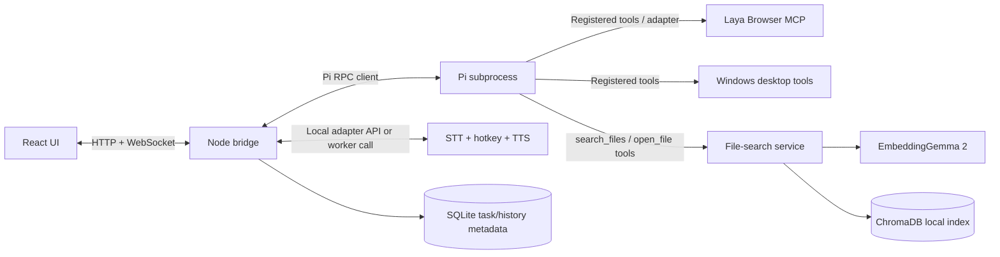

# VoicePilot — Backend Schema and API Contracts

**Version:** 1.0  
**Status:** Draft contract for parallel implementation  
**Related documents:** [Technical Requirements](02-technical-requirements.md), [App Flow](03-app-flow.md)

> This document interprets “background schema” as **backend schema**: data contracts, bridge API, event messages, action payloads, and local persistence.

## 1. Purpose

This document is the shared interface contract between React, the Node.js/TypeScript bridge, Pi RPC, Windows action tools, STT/TTS, and semantic file search. Agree on these shapes before implementation begins. Contracts can evolve, but updates should be made here and reflected in tests.

## 2. Service boundary



### Source-of-truth rules
- The bridge owns `task_id`, task lifecycle, approval records, audit events, and UI delivery.
- Pi owns planning and tool selection but cannot bypass bridge safety gates.
- Tool adapters own action execution and return verified results.
- The file-search service owns the mapping from opaque `result_id` to indexed paths.
- ChromaDB owns vector embeddings and chunk retrieval. SQLite may store approved roots and sync metadata, but do not duplicate the full vector store in SQLite.

## 3. API overview

The bridge binds to loopback by default. Paths below are logical recommendations for implementation and may be adjusted once the service skeleton is created.

### HTTP endpoints

| Method | Path | Purpose |
|---|---|---|
| `GET` | `/api/health` | Bridge and dependency health summary |
| `POST` | `/api/tasks` | Submit a typed/transcribed text command |
| `GET` | `/api/tasks/:taskId` | Read task status and step results |
| `POST` | `/api/tasks/:taskId/cancel` | Request cancellation when safe/supported |
| `POST` | `/api/approvals/:approvalId` | Approve or reject a pending action |
| `GET` | `/api/history?limit=50` | Recent tasks, newest first |
| `DELETE` | `/api/history` | Clear local task history |
| `GET` | `/api/settings` | Non-secret effective settings and provider status |
| `PATCH` | `/api/settings` | Update supported local preferences |
| `GET` | `/api/file-search/status` | Index/model/status information |
| `POST` | `/api/file-search/index` | Start indexing selected approved roots |
| `DELETE` | `/api/file-search/index` | Clear/rebuild file index according to request |

Raw audio upload may be an internal adapter endpoint or an IPC call. If implemented over HTTP, cap payload size, validate MIME/audio metadata, and use a one-time task/session token.

### WebSocket

Suggested path: `/ws`.

The bridge emits task, recording, transcript, plan, action, confirmation, and result events. The UI should treat events as authoritative state transitions and also be able to reload task state after reconnecting.

## 4. Common identifiers and enums

- IDs: opaque UUID/ULID strings such as `task_...`, `action_...`, `approval_...`, `result_...`.
- Timestamps: ISO 8601 UTC strings in JSON (e.g. `2026-10-10T04:30:00.000Z`).
- Task status: `created | recording | transcribing | interpreting | awaiting_approval | executing | succeeded | partially_succeeded | failed | blocked | cancelled`.
- Action status: `planned | needs_confirmation | queued | running | succeeded | failed | blocked | cancelled | skipped`.
- Approval status: `pending | approved | rejected | expired | cancelled`.
- Provider status: `available | initializing | unavailable | misconfigured`.

## 5. Request/response contracts

### 5.1 Health response

```json
{
  "status": "ok",
  "version": "0.1.0",
  "components": {
    "pi": "available",
    "stt": "available",
    "fileSearch": "initializing",
    "tts": "available",
    "browserTools": "available",
    "desktopTools": "available"
  },
  "timestamp": "2026-10-10T04:30:00.000Z"
}
```

Do not include secrets, full environment variables, file contents, or local credentials in health responses.

`components.pi` reports the Pi RPC process, while `components.desktopTools` reports the computer-use extension separately. A Pi process in RPC recovery mode is not desktop-ready: the bridge reports desktop tools as `misconfigured` and rejects desktop tasks until the extension has discovered the live CUA tool surface.

### 5.2 Create task request

`POST /api/tasks`

```json
{
  "input": {
    "type": "text",
    "text": "Open Notepad and set volume to 30 percent"
  },
  "source": "ui",
  "options": {
    "allowCloudFallback": false,
    "speakResponse": true
  }
}
```

Allowed input types for the public bridge contract are `text` and `transcript`. Raw binary audio uses a separate internal path. `allowCloudFallback` defaults to false unless the user explicitly enables it. The bridge returns `202 Accepted` with a task summary.

Response:

```json
{
  "taskId": "task_01ABC",
  "status": "executing",
  "transcript": "Open Notepad",
  "createdAt": "2026-10-10T04:30:00.000Z"
}
```

The bridge returns this initial state as soon as the task is persisted and accepted. The UI then polls `GET /api/tasks/:taskId` until the task reaches a terminal status. Only one desktop task may execute at a time; overlapping submissions receive `409 BUSY`.

`POST /api/tasks/:taskId/cancel` requests Pi RPC cancellation and returns `202` while the task resolves. Poll task status for the final state. A task is `cancelled` only when Pi reports an abort before the allowlisted action completes; if Notepad launched successfully, the task remains `succeeded`. Completed or unsupported cancellation requests return `409`.

### 5.3 Task status response

```json
{
  "taskId": "task_01ABC",
  "status": "executing",
  "transcript": "Open Notepad and set volume to 30 percent",
  "interpretation": "Open Notepad and set Windows master volume to 30%.",
  "steps": [
    {
      "actionId": "action_01",
      "action": "open_app",
      "label": "Open Notepad",
      "status": "succeeded",
      "summary": "Notepad window detected",
      "startedAt": "2026-10-10T04:30:00.100Z",
      "finishedAt": "2026-10-10T04:30:01.200Z"
    },
    {
      "actionId": "action_02",
      "action": "set_volume",
      "label": "Set volume to 30%",
      "status": "running"
    }
  ]
}
```

Do not return internal model chain-of-thought. Return only a concise interpretation, action plan, execution progress, and user-facing explanation.

## 6. WebSocket event envelope

All messages use a shared envelope:

```json
{
  "eventId": "evt_01ABC",
  "type": "task.status",
  "taskId": "task_01ABC",
  "timestamp": "2026-10-10T04:30:00.000Z",
  "data": {}
}
```

### Event types

| Event | `data` essentials | Purpose |
|---|---|---|
| `recording.started` | `source`, `hotkey` | UI switches to Listening |
| `recording.stopped` | `durationMs` | UI switches to Transcribing |
| `transcript.ready` | `text`, `language?`, `latencyMs` | Show transcript |
| `task.created` | `status` | New task initialized |
| `task.status` | `status`, `message?` | High-level progress |
| `plan.ready` | `steps[]`, `requiresApproval[]?` | Present action plan where needed |
| `action.started` | `actionId`, `action`, `label` | Current step begins |
| `action.finished` | `actionId`, `status`, `summary`, `durationMs`, `errorCode?` | Show real result |
| `approval.required` | `approvalId`, `actionId`, `reason`, `expiresAt` | Open approval dialog |
| `approval.resolved` | `approvalId`, `status` | Close approval dialog and resume/block |
| `task.finished` | `status`, `summary` | Final state |
| `notification` | `level`, `message` | Non-blocking UI feedback |
| `component.status` | `component`, `status`, `message?` | Settings/health display |

The bridge should retain enough recent event/task state for the UI to recover after a transient WebSocket reconnect.

The MVP event stream is loopback-only and accepts WebSocket upgrades at `/ws` only from the configured VoicePilot UI origin. It retains and replays the latest 100 task events after reconnect. The UI also polls task status as a recovery path if the socket is unavailable.

## 7. Action tool contracts

The tool adapter must validate these arguments with a runtime schema (e.g. Zod/Pydantic) before any OS action occurs.

### 7.1 `open_app`

```json
{ "appId": "notepad" }
```

Rules:
- `appId` must map to a configured allowlist entry.
- The model does not supply a full executable path or shell command.
- Return actual launch/window evidence where available.

### 7.2 `close_app`

```json
{ "appId": "notepad", "closeMode": "graceful" }
```

Rules:
- Graceful close only by default.
- Use confirmation if unsaved work is possible or the outcome is uncertain.
- Force termination is excluded from normal MVP tools.

### 7.3 `scroll_window`

```json
{ "direction": "down", "amount": 450, "target": "active-window" }
```

Rules:
- `direction` is `up | down`.
- `amount` must be bounded (suggested initial limit 1,200 logical pixels/steps; calibrate to implementation).
- Do not accept arbitrary coordinates from the LLM for general click automation if an accessible element-based tool is available.

### 7.4 `set_volume`

```json
{ "level": 30 }
```

Rules:
- Number only, integer 0–100.
- Read volume back after setting.
- Return both requested and actual level if available.

### 7.5 `toggle_mute`

```json
{ "muted": true }
```

This form sets mute state explicitly; avoid a toggle-only API when repeated requests could invert state unexpectedly.

### 7.6 `search_web`

```json
{ "query": "TinyViT federated learning" }
```

Rules:
- Query length capped (suggested maximum 500 characters).
- Use a configured search engine/approved search URL.
- Return opened URL/title where possible; do not evaluate raw model-provided JavaScript.

### 7.7 `browser_navigate`

```json
{ "operation": "back" }
```

Allowed operations: `back | forward | refresh`. URL navigation, if enabled, must validate scheme and policy before dispatch.

### 7.8 `search_files`

```json
{ "query": "notes about federated learning", "limit": 5 }
```

Response:

```json
{
  "results": [
    {
      "resultId": "result_01ABC",
      "fileName": "FL-notes.pdf",
      "extension": ".pdf",
      "rootRelativePath": "Research/FL-notes.pdf",
      "snippet": "...federated optimization across clients...",
      "modifiedAt": "2026-10-08T10:00:00.000Z",
      "score": 0.81
    }
  ]
}
```

Rules:
- Limit must be 1–10.
- UI should not treat cosine/distance scores as calibrated probabilities. Display a relevance label or omit the numeric score unless calibrated.
- The vector store maps `resultId` to a canonical path server-side.

### 7.9 `open_file`

```json
{ "resultId": "result_01ABC" }
```

Rules:
- Only accepts a result ID returned by a recent authorized search. Never accept a free-form filesystem path from the model.
- Resolve canonical path server-side; ensure path remains under an approved root and file still exists.
- Open through a safe Windows file-opening call, not a constructed shell command.

## 8. Approval schema

```json
{
  "approvalId": "approval_01ABC",
  "taskId": "task_01ABC",
  "actionId": "action_02",
  "action": "close_app",
  "targetLabel": "Notepad",
  "reason": "Unsaved work may be lost.",
  "status": "pending",
  "createdAt": "2026-10-10T04:30:00.000Z",
  "expiresAt": "2026-10-10T04:31:00.000Z"
}
```

Approval submission:

```json
{ "decision": "reject" }
```

Allowed decisions: `approve | reject`. The bridge performs an atomic state transition from `pending`. Any stale, duplicate, or expired approval request is rejected. A rejected request must never dispatch the action.

## 9. Local persistence schema

SQLite is recommended for task history, approvals, approved roots, and file sync metadata. ChromaDB remains responsible for vector embeddings.

### 9.1 `tasks`

```sql
CREATE TABLE tasks (
  task_id TEXT PRIMARY KEY,
  input_source TEXT NOT NULL,
  transcript TEXT,
  interpretation TEXT,
  status TEXT NOT NULL,
  started_at TEXT,
  finished_at TEXT,
  summary TEXT,
  error_code TEXT,
  created_at TEXT NOT NULL
);
```

### 9.2 `actions`

```sql
CREATE TABLE actions (
  action_id TEXT PRIMARY KEY,
  task_id TEXT NOT NULL,
  ordinal INTEGER NOT NULL,
  action_name TEXT NOT NULL,
  safe_args_json TEXT NOT NULL,
  status TEXT NOT NULL,
  started_at TEXT,
  finished_at TEXT,
  duration_ms INTEGER,
  summary TEXT,
  error_code TEXT,
  FOREIGN KEY(task_id) REFERENCES tasks(task_id)
);
```

`safe_args_json` must omit credentials, raw audio, secrets, and unnecessary document contents. Store only arguments safe for local history.

### 9.3 `approvals`

```sql
CREATE TABLE approvals (
  approval_id TEXT PRIMARY KEY,
  task_id TEXT NOT NULL,
  action_id TEXT NOT NULL,
  status TEXT NOT NULL,
  reason TEXT NOT NULL,
  created_at TEXT NOT NULL,
  expires_at TEXT NOT NULL,
  resolved_at TEXT,
  FOREIGN KEY(task_id) REFERENCES tasks(task_id),
  FOREIGN KEY(action_id) REFERENCES actions(action_id)
);
```

### 9.4 `approved_roots`

```sql
CREATE TABLE approved_roots (
  root_id TEXT PRIMARY KEY,
  canonical_path TEXT NOT NULL UNIQUE,
  display_name TEXT NOT NULL,
  enabled INTEGER NOT NULL DEFAULT 1,
  added_at TEXT NOT NULL
);
```

Validate and canonicalize each root at registration time and again when opening a result.

### 9.5 `file_index_metadata`

```sql
CREATE TABLE file_index_metadata (
  file_key TEXT PRIMARY KEY,
  root_id TEXT NOT NULL,
  canonical_path TEXT NOT NULL,
  file_name TEXT NOT NULL,
  extension TEXT,
  modified_at TEXT,
  content_hash TEXT NOT NULL,
  indexed_at TEXT NOT NULL,
  index_status TEXT NOT NULL,
  FOREIGN KEY(root_id) REFERENCES approved_roots(root_id)
);
```

Do not store embedding arrays here; use ChromaDB. Chroma metadata should minimally include `file_key`, `chunk_index`, `root_id`, `canonical_path` (local service only), `file_name`, `extension`, `modified_at`, `content_hash`, and a bounded chunk/snippet. Avoid exposing canonical paths directly to the UI.

## 10. Suggested settings schema

```json
{
  "hotkey": "Alt+M",
  "stt": { "provider": "local", "model": "pending-benchmark" },
  "llm": { "provider": "local", "model": "gemma-4-e2b", "allowCloudFallback": false },
  "tts": { "enabled": true, "provider": "piper", "voiceId": "configured-voice" },
  "fileSearch": { "enabled": true, "model": "google/embeddinggemma-2", "maxResults": 5 },
  "safety": { "maxStepsPerTask": 5, "approvalTimeoutSeconds": 60 },
  "privacy": { "persistRawAudio": false, "persistTranscriptHistory": true }
}
```

This is a logical shape, not a secret store. Credentials should live in environment variables or OS-protected local storage and must never be returned by `/api/settings`.

## 11. Standard error codes

| Code | Meaning | UI guidance |
|---|---|---|
| `STT_NO_SPEECH` | No usable speech detected | Ask user to repeat |
| `STT_UNAVAILABLE` | Transcription service/model unavailable | Retry or use typed input |
| `PI_UNAVAILABLE` | Pi process not running/failed | Show restart/retry instructions |
| `LLM_TIMEOUT` | LLM failed to respond in time | Preserve transcript; offer retry |
| `UNSUPPORTED_ACTION` | Tool not in allowlist | Explain limitation |
| `INVALID_ARGUMENT` | Tool parameters failed schema validation | Ask a focused clarification |
| `APP_NOT_ALLOWED` | App not in allowlist | Ask user to configure a supported app |
| `APP_LAUNCH_FAILED` | Windows launch could not be verified | Show failure, allow retry |
| `APP_CLOSE_NEEDS_APPROVAL` | Approval required | Show confirmation dialog |
| `APPROVAL_EXPIRED` | Pending approval timed out | Require a new request |
| `ACTION_CANCELLED` | Action/task cancelled | Show cancellation state |
| `BROWSER_TOOL_UNAVAILABLE` | Laya/MCP path unavailable | Offer retry or simpler search path |
| `FILE_SEARCH_UNAVAILABLE` | Embedding/index service unavailable | Clarify that no search was performed |
| `FILE_NOT_FOUND` | Result no longer exists | Refresh index/re-run search |
| `FILE_OUTSIDE_APPROVED_ROOT` | Path validation failed | Block opening and log security event |
| `VOLUME_SET_FAILED` | Windows audio API failed | Report that volume was not verified |
| `TTS_UNAVAILABLE` | Speech synthesis failed | Keep text response |

## 12. Contract-level security tests

- Unknown action type is rejected before execution.
- `open_app` cannot accept a command-line string or executable path from the model.
- `open_file` rejects arbitrary paths, path traversal, stale result IDs, and files outside approved roots.
- Browser navigation rejects disallowed URL schemes.
- Rejecting or expiring an approval never invokes the action tool.
- Replaying an approval response does not execute an action twice.
- LLM output containing shell instructions is treated as content, not executed.
- UI cannot query or change another user's local files remotely; bridge is loopback-only and validates origin.
- History clear removes stored task/action history; file-index clear is a separate explicit operation.
